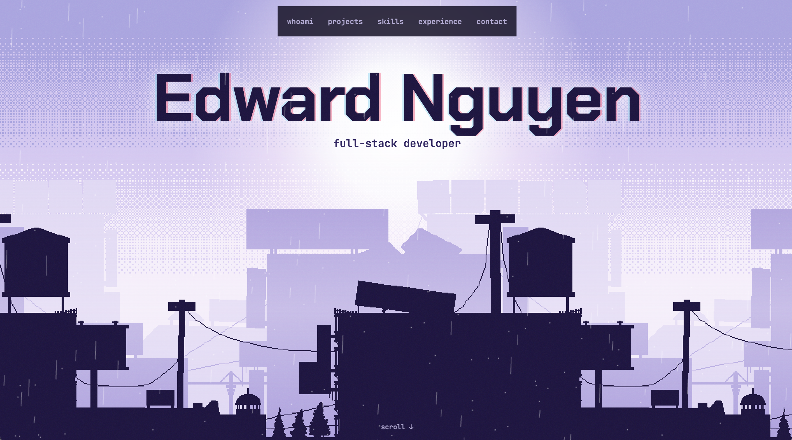

# Portfolio

## Overview
Built with [Astro](https://astro.build) and deployed on Cloudflare Workers (static assets). Taken parallax inspiration from [raseraa0](https://github.com/Raseraa0/raseraa0.github.io/blob/main/README.md?plain=1) portfolio website, and the theme was inspired by Trigger Studio's Cyberpunk Edgerunners 2 "Watson".

## Commands
| Command             | Action                                      |
| ------------------- | ------------------------------------------- |
| `npm install`       | Install dependencies                        |
| `npm run dev`       | Start the dev server at `localhost:4321`    |
| `npm run build`     | Build the static site to `./dist/`          |
| `npm run preview`   | Preview the production build locally        |
| `npm run check`     | Type-check `.astro` and `.ts` files         |

## Layout

- `src/` — pages, components, data and styles
- `public/layers/` — pixel-art layers for the hero and contact scenes (served as-is)
- `portfolio-designs/` — the design spec (`DESIGN.md`), screenshots and the reference prototype

## Deploy

Cloudflare Workers Builds, connected to this repo. Build command `npm run build`; `wrangler.jsonc` serves `dist/` as static assets. `main` deploys to production, other branches upload a preview version. Node version comes from `.node-version`.
